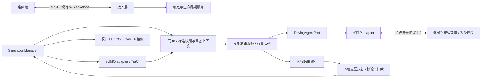

# 大模型控制 SUMO 车辆：接口设计

> - 版本：v0.1
> - 状态：Proposed（接口设计草案，尚未实现）
> - 日期：2026-10-20
> - 代码基线：`da1da42`
> - 适用范围：TrafficVerse 后端、驾驶智能体服务、桌面端配置与监控

## 1. 设计结论与范围

通过现有车辆控制链路接入大模型：大模型读取结构化交通观察，低频输出速度、加速度和换道
意图；本地控制器在每个仿真步重新校验并执行意图，SUMO 继续决定实际车辆运动。

首版采用异步闭环，先支持纯二维 SUMO 实验中的 1～5 辆指定车辆，每个实验绑定一个驾驶
智能体服务。其余车辆沿用原控制方式。模型供应商可以替换，TrafficVerse 与服务之间使用本文
定义的统一驾驶协议。默认关闭此功能，既有 Core Run 不依赖模型服务。

本文规定两类接口：

1. **产品接口**：UI 通过 REST 管理实验的控制器绑定，通过现有 WebSocket 获取结果和接管车辆。
2. **驾驶决策接口**：TrafficVerse 异步调用外部驾驶智能体服务，以批量观察换取批量驾驶意图。

首版不开放坐标瞬移、车辆生成/删除、路线重写、信号灯控制或任意 TraCI 调用；也不要求模型
生成方向盘、油门和刹车踏板值。这些能力超出现有 `ControlCommand` 的运动控制边界。

本文中的端点、模型、配置和错误码均为拟新增内容，不能视为当前已经可调用的 API。设计评审
通过后，再同步 PRD、System Design、Agent Guide 并实施；本文不改变已接受的 ADR。

## 2. 当前实现与接入差距

| 当前实现 | 位置 | 本次设计的接入方式 |
|---|---|---|
| 场景规则控制器 | `src/trafficverse/controllers/mixed_automation.py` | 在绑定车辆上由新控制器接管，避免同车双重控制 |
| 同步 `controller.step(previous, dt_s)` | `src/trafficverse/application/simulation_manager.py` | 保持同步、无网络 I/O，只读取已校验的决策缓存 |
| 先控制，再 SUMO step，再采集快照 | 同上 | 保持次序，模型服务无 step 权限 |
| 速度/加速度/相对换道命令 | `src/trafficverse/domain/models/vehicle.py` | 保留既有能力，补充内部绝对目标车道和显式释放语义 |
| TraCI 执行 | `src/trafficverse/adapters/sumo/` | 增加必要观察、逐项回执及控制释放实现 |
| API 智能体资产 | `src/trafficverse/domain/models/workspace.py` | 复用 URL、模型 ID、凭证环境变量名称，并在 prepare 时冻结副本 |
| 智能体页面默认条目 | `ui/views/agent_asset_page.py` | 默认 mock 条目不能通过真实连接检查或绑定为已接通模型 |
| `apply_controls()` 返回 `None` | `src/trafficverse/ports/simulation.py` | 改为有类型的逐车结果，区分指令接收与运动完成 |

现有 `VehicleState` 不包含完整的车身尺寸、沿车道位置、相邻车道可达性、前后间距和下一信号灯
距离。仅将现有车辆列表直接发给模型不足以支持可靠换道，实施时必须补齐这些观察。

另一个必要差距是释放控制：目前 `desired_speed_mps` 不接受负值，且没有独立 release 方法。
把某辆车从命令字典中删除，不等于撤销此前已经交给 SUMO 的速度指令。

## 3. 系统边界与模块职责



- **模型服务**负责理解观察并选择意图，不持有 TraCI connection，不推进仿真。
- **应用服务**负责异步请求、超时、队列、生命周期、结果缓存和审计；不导入第三方模型 SDK。
- **controllers** 负责纯策略、当前状态校验和意图转换，不访问 HTTP、数据库或 WebSocket。
- **SUMO adapter** 负责 SDK 数据转换和命令执行。额外读数也由 manager 在串行仿真边界发起。
- **SimulationManager** 仍是唯一推进者，保持 `control → SUMO step → snapshot → ROI/CARLA → publish`。
- **UI、指标、回放**继续使用 SUMO 产生的状态。模型的预测、说明和期望动作不写入权威轨迹。

LLM 模式下禁止向模型暴露现有 `safety_checks_override`、`lane_change_mode` 或任意 SDK 方法名。
不能为获得模型想要的动作而关闭 SUMO 的跟驰、路权、红灯和换道安全约束。

## 4. 时间、调度与控制权

### 4.1 两个时钟与初始参数

| 参数 | 首版建议值 | 语义 |
|---|---|---|
| `step_ms` | Core Run 为 50；二维包沿用自身配置 | 权威仿真步长，不因模型变慢而改变 |
| `decision_interval_ms` | 1000 | 按仿真时间触发一次批量观察 |
| `request_timeout_ms` | 2000 | HTTP 请求的墙上时间上限，使用单调时钟 |
| `max_observation_age_ms` | 3000 | 结果首次执行时，允许的观察年龄，按仿真时间计算 |
| `action_ttl_ms` | 1000 | 自首次执行 tick 起的意图有效期，按仿真时间计算 |
| `max_controlled_vehicles` | 5 | 每实验最多绑定车辆数 |
| `max_in_flight_requests` | 1 | 每实验最多一个在途批量推理 |

这些数值是可调设计初值，尚无性能验收结论。`decision_interval_ms`、`action_ttl_ms` 和
`max_observation_age_ms` 必须为当前 `step_ms` 的整数倍。模型超时与动作有效期不能共用一个字段。

模型每秒决策一次，不代表每秒才控制一次车辆。本地控制器在每个 tick 根据最新快照检查意图、
计算受限命令；模型请求始终在 tick 锁之外运行。

### 4.2 单次闭环

1. manager 首次正常 step 得到 `S(t)`；在首次快照前不向模型编造观察，车辆使用原生 SUMO 行为。
2. manager 在同一 SUMO 时间采集驾驶上下文，产生不可变 `DrivingContextSnapshot`，只投递到
   有界观察队列，不等待推理。没有绑定车辆在场时不发请求。
3. worker 将观察构造成 `DrivingDecisionRequest`，调用 `DrivingAgentPort`。
4. 收到响应后进行协议校验，结果只进入有界缓存；worker 不直接调用 SUMO 或修改控制权。
5. 下一次 `run_tick()` 的控制阶段，manager 在串行边界取出结果并校验 experiment、epoch、
   binding revision、观察版本、当前车辆存在性和观察年龄，再按车辆接受或拒绝。
6. 通过校验的意图从该 tick 开始生效，本地控制器生成指令，SUMO 执行后产生新的真实状态。
7. 超时、缺失、拒绝或到期时切换到明确的释放流程，并记录降级；不能无限沿用旧意图。

例如：观察时间为 10000 ms，响应在控制阶段的当前快照时间 11200 ms 被消费，则首次执行的
目标 tick 为 11250 ms。以目标 tick 校验观察年龄后，有效期设为
`[11250, 12250)` ms。有效期只在首次接受时计算，逐 tick 执行不能刷新它。

观察年龄校验公式为：

```text
age_ms = target_tick_simulation_time_ms - observation_simulation_time_ms
accept only if 0 < age_ms <= max_observation_age_ms
```

同车只接受 `observation_sequence` 严格大于最后接受值的新响应。响应不得引用未来观察。
更高版本的有效意图替换旧意图；一份完整响应中某车缺失、拒绝或校验失败，意味着该车的新一轮
决策不可用，撤销其旧缓存并进入降级。纯请求超时则允许尚未到期的旧意图自然执行到原到期点。

倍速只改变墙上时间调度。倍速越高，模型结果越容易过期；过期率必须可见。首个真实验收用
1×，不承诺任意倍速都能获得同样的模型覆盖率，也不偷偷扩大 TTL。离线等待模型后再步进的
研究模式留待后续设计，不混入首版异步调度。

### 4.3 队列与背压

| 队列/缓存 | 容量 | 满载策略 |
|---|---|---|
| 待发送观察 | 1 个批次 | 新观察替换尚未发送的旧观察，累计 `observations_replaced` |
| 在途请求 | 1 个批次 | 不并发追加，只保留最新待发送观察 |
| 待消费结果 | 1 个批次 | 保留版本更新的结果，旧结果记录为丢弃 |
| 当前意图 | 每绑定车辆 1 条 | 新有效意图替换旧意图 |
| 审计写队列 | 256 个批次 | 返回失败并标记审计不完整；下一 manager 边界使实验失败并清理 |

worker 发送前再次检查观察年龄；已过期的观察不花费推理请求。所有队列都以完整批次为单位，
不能拆分成无界的逐车任务。网络等待和审计落盘不得占用 manager 的 tick 锁。
审计拒绝入队后不得继续接受或执行新的模型意图；已经提交的运动不能回滚，应在最终状态中
保留 `CONTROL_AUDIT_OVERFLOW` 和不完整标记，不得把该次运行作为审计完整的成功结果。

### 4.4 控制权与生命周期

每辆车每 tick 只有一个控制来源，优先级为：

```text
停止/失败清理 > 本地即时风险约束 > 人工临时接管 > 有效模型意图 > SUMO 原生行为
```

未绑定车辆继续使用既有场景控制器。绑定车辆从原场景规则控制器的输出中排除，不能再使用
简单的字典覆盖把模型纵向指令与原规则横向指令拼接。首版采用明确 vehicle ID，prepare 时
验证它们属于该运行快照中的显式车辆需求；尚未发车者等待出现，不向其下发指令。动态 flow
车辆选择器和按等级自动扩展留待后续版本。

每实验维护递增 `control_epoch`。pause、resume、人工接管开始/结束、停止和运行重建都使旧
epoch 失效，并清空待发送观察、结果和意图。绑定配置的 `revision` 与运行期 epoch 分别管理。

| 生命周期事件 | 行为 |
|---|---|
| prepare | 冻结资产/配置、验证 ID 和安全模式、连接检查；不推进 SUMO |
| start | 首帧使用原生行为，取得真实观察后请求决策 |
| pause | 取消在途请求并失效缓存；不调用 step/tick；登记下次运行前待释放的车辆 |
| resume | 在首个控制阶段先释放旧覆盖，再从最新状态重新采样 |
| 车辆离网 | 删除意图、接管租约和缓存；记为 `VEHICLE_GONE`，不再尝试释放不存在的车 |
| stop/failure | 停止投递、失效 epoch、取消并等待 worker，清理控制覆盖，按既有流程关闭 CARLA 后关闭 SUMO |
| 重复 close | 稳定返回，不遗留 HTTP client、任务或队列 |

取消必须在清理后传播 `CancelledError`；无法及时取消的远端响应也会因旧 epoch 被丢弃。
带有强制碰撞、关闭安全检查或冻结事故车辆的演示规则，不直接作为首版 LLM 验收场景；prepare
应拒绝绑定车辆与这些规则冲突的配置，先使用安全模式的普通跟驰/换道场景。

## 5. 驾驶观察契约

### 5.1 数据来源与坐标

新建观察模型，不为方便而改变既有 `VehicleState` 的冻结字段含义：

- 动态值来自同 tick 的 SUMO 采样，包括车辆尺寸、沿车道位置、间距、允许速度、受控连接的
  当前灯色以及实际车道权限；静态拓扑来自本次运行实际 `.net.xml`。
- `ObservationBuilder` 为纯转换逻辑，接收已标准化上下文；TraCI 额外查询只存在于 SUMO adapter。
- `position_m` 是当前 SUMO 路网的本地米制坐标，不是经纬度；朝向使用现有数学弧度约定。
  间距沿车道/可连接路线计算，不能用欧氏距离把对向车、跨层道路车辆误作前车。
- `gap_m` 为车身边界间净距；`distance_m` 为沿行驶路径到停止线等对象的距离。
- 未获取到的数据用 `null` 和明确完整性状态表达，不能把“未观测”解释为“车道无车”。
- 不将完整地图、相机画面、全部车辆历史或完整系统环境发给模型。

### 5.2 命名模型

| 模型 | 关键字段与约束 |
|---|---|
| `DrivingDecisionRequest` | 协议版本、请求 ID、实验 ID、epoch、绑定 revision、观察时间/sequence、模型与策略版本、推理预算、车辆观察 |
| `DrivingInferenceBudget` | `max_input_tokens`、`max_output_tokens`、`request_timeout_ms`，均为正整数 |
| `DrivingVehicleObservation` | `ego`、`neighbors`、`lane_options`、`next_signal`、`goal`、`allowed_actions`、`context_status` |
| `DrivingEgoState` | `vehicle_id`、`automation_level`、`position_m`、`heading_rad`、`lane_id`、`lane_position_m`、`route_id`、速度/加速度、长宽、当前允许速度和车辆动力学上限 |
| `DrivingNeighbor` | `vehicle_id`、相对角色、`lane_id`、`gap_m`、`speed_mps`、`length_m`、`width_m` |
| `DrivingLaneOption` | `lane_id`、`relative_direction`、`is_reachable`、`is_route_compatible`、`speed_limit_mps`、`front_gap_m`、`rear_gap_m`、`context_complete` |
| `DrivingSignalObservation` | `signal_id`、`distance_m`、`phase`、`remaining_ms`；无受控灯时整体为 `null` |
| `DrivingGoal` | `type` 固定为 `FOLLOW_ASSIGNED_ROUTE`，`cruise_speed_mps` 来自已冻结配置 |

`neighbors` 首版最多 8 项，优先包含本车道与左右候选车道的前后车；超出可表达范围时
`context_status=TRUNCATED`。观测查询范围不足、候选车道权限未知或上下文不完整时，模型可以
提出意图，但本地必须拒绝对应换道；复杂路口的控制首版降级回 SUMO。尺寸和动力学约束读取
本次车辆实际 vType，不用所有车辆统一 4.8 m 等展示假设。

### 5.3 请求示例

以下示例为一个正常道路上的单车请求；所有字段属于本文拟定义的模型。

```json
{
  "schema_version": "1.0",
  "request_id": "10000000-0000-4000-8000-000000000001",
  "experiment_id": "20000000-0000-4000-8000-000000000001",
  "control_epoch": 1,
  "binding_revision": 1,
  "observation_simulation_time_ms": 10000,
  "observation_sequence": 200,
  "model_id": "configured-driving-model",
  "policy_version": "driving-policy/1.0",
  "map_id": "safe-merge-example",
  "step_ms": 50,
  "inference_budget": {
    "max_input_tokens": 16000,
    "max_output_tokens": 2048,
    "request_timeout_ms": 2000
  },
  "vehicles": [
    {
      "ego": {
        "vehicle_id": "ego_L5_001",
        "automation_level": "L5",
        "position_m": {"x": 80.0, "y": 6.4, "z": 0.0},
        "heading_rad": 0.0,
        "lane_id": "main_1",
        "lane_position_m": 80.0,
        "route_id": "main_route",
        "speed_mps": 14.0,
        "acceleration_mps2": 0.0,
        "length_m": 4.8,
        "width_m": 1.8,
        "allowed_speed_mps": 16.7,
        "max_acceleration_mps2": 2.5,
        "max_deceleration_mps2": 4.5
      },
      "neighbors": [
        {
          "vehicle_id": "leader_001",
          "role": "LEADER",
          "lane_id": "main_1",
          "gap_m": 18.0,
          "speed_mps": 9.0,
          "length_m": 4.8,
          "width_m": 1.8
        }
      ],
      "lane_options": [
        {
          "lane_id": "main_2",
          "relative_direction": "LEFT",
          "is_reachable": true,
          "is_route_compatible": true,
          "speed_limit_mps": 16.7,
          "front_gap_m": 40.0,
          "rear_gap_m": 35.0,
          "context_complete": true
        }
      ],
      "next_signal": null,
      "goal": {"type": "FOLLOW_ASSIGNED_ROUTE", "cruise_speed_mps": 15.0},
      "allowed_actions": ["TARGET_SPEED", "TARGET_ACCELERATION", "CHANGE_LANE", "RELEASE_CONTROL"],
      "context_status": "COMPLETE"
    }
  ]
}
```

候选车道净距为 `null` 且 `context_complete=true` 时，表示已在配置的观测距离内确认无该方向
邻车；必须结合已冻结的 `observation_range_m` 理解，不能等同于无限空旷。具体查询范围写入
运行配置快照，局部校验使用实际当前上下文，不依赖模型对空值的解释。

## 6. 外部驾驶决策接口

### 6.1 HTTP 约定

```http
POST {api_base_url}/driving-decisions
Content-Type: application/json
Accept: application/json
Authorization: Bearer <value resolved from credential_env_var>
X-Request-ID: <request_id>
```

`api_base_url` 是版本化驾驶服务根地址，例如 `https://agent.example.com/v1`。它必须提供本文
驾驶协议；任意模型厂商的通用聊天端点不能直接填写后即认为可用。需要厂商模型时，由驾驶
网关完成提示构造、模型调用和结构化输出转换；TrafficVerse 的领域层不依赖厂商协议。

- 请求与响应分别是 `DrivingDecisionRequest`、`DrivingDecisionResponse`，均使用 UTF-8 JSON。
- HTTP 200 表示收到一份决策结果，不表示车辆已经执行。禁止 SSE 和边生成边执行动作。
- 请求上限 65536 bytes，响应上限 32768 bytes；超限终止请求，不能静默截断 JSON。
- 同一请求不自动重试推理，以免放大延迟和重复计费；下一轮以新观察、新 `request_id` 请求。
  网关如自行重试，必须仍受单次请求总 deadline 限制。
- `request_id` 在实验内唯一；重复结果只消费一次。已知重复请求若由网关缓存，应返回同一结果，
  不能假设所有厂商天然支持幂等推理。
- 凭证由后端在连接时解析；缺失环境变量在 prepare 失败。响应不回显凭证。

连接检查使用同一版本根下的 `GET {api_base_url}/capabilities`，返回命名模型
`DrivingAgentCapabilities`：`protocol_version`、`supported_actions`、`max_batch_vehicles`、
`available_model_ids`、`supported_policy_versions`。该端点不进行车辆控制。连接、协议、
策略版本和模型选择必须在 prepare 验证；
首版绑定后无法连接就拒绝 READY，运行期间临时故障则按第 8 节降级。

网关必须执行请求中的 `inference_budget`，允许施加更严格的服务端预算，不能擅自放大；
超预算返回稳定错误。HTTP client 仍独立按本地 deadline 取消请求，不能依赖服务端自报超时。

### 6.2 结构化响应

```json
{
  "schema_version": "1.0",
  "request_id": "10000000-0000-4000-8000-000000000001",
  "experiment_id": "20000000-0000-4000-8000-000000000001",
  "control_epoch": 1,
  "binding_revision": 1,
  "observation_simulation_time_ms": 10000,
  "observation_sequence": 200,
  "model_id": "configured-driving-model",
  "model_revision": null,
  "actions": [
    {
      "type": "DRIVE",
      "vehicle_id": "ego_L5_001",
      "longitudinal": {"type": "TARGET_SPEED", "target_speed_mps": 12.0},
      "lateral": {"type": "CHANGE_LANE", "target_lane_id": "main_2"},
      "reason_code": "OVERTAKE_SLOW_LEADER"
    }
  ],
  "rejections": [],
  "usage": {"input_tokens": 820, "output_tokens": 110}
}
```

外层关联字段由网关从请求复制，不要求模型生成 UUID 或时间戳。模型只产生白名单意图；网关
校验一遍，TrafficVerse 收到后仍独立校验。`model_revision` 无法从供应商取得时为 `null`，
此时实验必须注明模型版本未完全固定，不能声称重新推理可确定性复现。

| 模型 | 内容 |
|---|---|
| `DrivingDecisionResponse` | 示例中的固定外层字段；`usage` 可为 `null`，其余列表允许为空 |
| `DrivingAction` | 判别联合：`DriveIntent` 或 `ReleaseControlIntent` |
| `DriveIntent` | `type=DRIVE`、`vehicle_id`、`longitudinal`、`lateral`、`reason_code` |
| `LongitudinalIntent` | 二选一：`TARGET_SPEED + target_speed_mps` 或 `TARGET_ACCELERATION + target_acceleration_mps2` |
| `LateralIntent` | 二选一：`KEEP_LANE` 或 `CHANGE_LANE + target_lane_id` |
| `ReleaseControlIntent` | `type=RELEASE_CONTROL`、`vehicle_id`、`reason_code`，不带运动参数 |
| `DrivingDecisionRejection` | `vehicle_id`、`code`、最长 200 字符的 `message` |
| `ModelUsage` | 非负整数 `input_tokens`、`output_tokens`，不参与驾驶决策 |

所有模型拒绝未知字段；所有数值必须有限，拒绝 NaN/Infinity、字符串代替数字及布尔值代替数字。
速度非负，车道 ID 必须来自本次观察中的候选车道。`reason_code` 使用稳定枚举，例如
`FOLLOW_ROUTE`、`FOLLOW_LEADER`、`OVERTAKE_SLOW_LEADER`、`YIELD`、`STOP_FOR_SIGNAL`、
`INSUFFICIENT_CONTEXT`；首版不接收自由推理过程，也不执行模型生成的代码或工具调用。

`actions` 与 `rejections` 中的车辆 ID 合起来必须唯一，且只能属于本次请求。重复 ID、越权 ID、
关联字段不匹配或顶层结构非法使整批失败。合法批次中某一动作字段非法只拒绝该车，其他合法
动作继续处理；实现时分两阶段校验外层与逐项动作。请求中未出现在两个列表里的车辆按
`AGENT_ACTION_MISSING` 处理。模型拒绝可用 `INSUFFICIENT_CONTEXT` 等 code，不得用伪动作补齐。

### 6.3 服务错误

非 2xx 使用统一的 `error.code/message/details/trace_id` 结构；`details` 采用命名的
`DrivingErrorDetails`（可选 `request_id`、`vehicle_id`、`retry_after_ms`），不接受任意扩展字典。
错误说明为英文且不得包含提示词全文、secret 或本机路径。

| HTTP 状态 | 服务错误 | TrafficVerse 行为 |
|---|---|---|
| 400/422 | 请求/协议不支持 | 本批降级，记录配置或契约故障 |
| 401/403 | 凭证/访问失败 | 打开熔断，提示修复配置；不自动反复重试 |
| 429 | 服务限流 | 本批降级，在墙上时间冷却期内不再请求 |
| 500/503、连接失败、超时 | 服务不可用 | 本批降级，累计熔断计数 |

## 7. 产品侧接口

### 7.1 复用资产与新增绑定资源

继续使用现有工作区 `agent-assets` CRUD 保存 API 根地址、`model_id` 和凭证变量名；资源存在
不代表连接可用。新增实验级单一绑定资源，首版只能在 `CREATED` 状态创建、替换和删除：

| 方法与路径 | 模型 | 语义 |
|---|---|---|
| `GET /api/v1/experiments/{experiment_id}/controller-binding` | `ControllerBindingView` | 查看配置 revision 和冻结摘要；无绑定返回 404 |
| `PUT /api/v1/experiments/{experiment_id}/controller-binding` | `ControllerBindingWrite → ControllerBindingView` | 创建或整体替换；不发起长时间推理 |
| `DELETE /api/v1/experiments/{experiment_id}/controller-binding` | 204 | 在 prepare 前解除绑定；重复删除稳定返回 204 |
| `GET /api/v1/experiments/{experiment_id}/controller-status` | `ControllerStatusView` | 查看健康、各车控制来源、最近观察/决策与降级原因 |

```json
{
  "schema_version": "1.0",
  "agent_api_id": "30000000-0000-4000-8000-000000000001",
  "controller_config_id": "llm-default",
  "vehicle_ids": ["ego_L5_001"]
}
```

`controller_config_id` 只能引用后端注册的类型化 YAML 配置，不能传入任意路径。车辆 ID 非空且
不重复，数量不超过配置上限；资产必须属于实验工作区。每份运行快照冻结资产字段、控制配置、
车辆列表及策略版本，运行期间删除或修改资产不会改变已经 prepare 的实验。

桌面启动流程调整为“选择资产/车辆 → 创建实验 → PUT 绑定 → prepare → start”；必须在现有
自动 prepare 之前完成绑定，绑定失败就停留配置页并显示恢复建议，不启动一个看似使用模型、
实际未绑定的实验。关闭模型选项时继续走原启动流程。

创建使用 `If-None-Match: *`，替换/删除使用 `If-Match: "<revision>"`。成功响应返回 ETag；
缺少必要条件返回 428，版本冲突返回 412，状态冲突返回 409。相同创建重试使用同一个
`Idempotency-Key`；同键同请求返回原结果，同键不同请求返回 409。幂等记录生命周期与实验一致。

`ControllerBindingView` 包括 `schema_version`、`experiment_id`、`revision`、上述配置字段和
`resolved_config_hash`；prepare 前 hash 为 `null`。`ControllerStatusView` 包括
`experiment_id`、`control_epoch`、`component_health`、`vehicles`；每车状态使用命名的
`VehicleControllerStatus`，包含 `vehicle_id`、`source`、`last_request_id`、观察版本、意图
到期时间、最新错误码。不存在的运行资源沿用统一 404 错误结构。

### 7.2 WebSocket 命令与事件

沿用 `/api/v1/ws?experiment_id=...` 和 `WebSocketEnvelope` 的 `schema_version="1.0"`，
不得新增绕开 envelope 的消息通道。新增 payload 使用各自命名模型：

| `type` | 方向 | 作用 |
|---|---|---|
| `vehicle.control.override` | UI → 后端 | 人工接管一个绑定车辆，携带完整意图和 `takeover_duration_ms` |
| `vehicle.control.release` | UI → 后端 | 提前结束该车人工租约，失效旧 epoch，重新请求模型 |
| `agent.decision.received` | 后端 → UI | 收到并完成协议校验；不表示车辆已经运动 |
| `agent.decision.rejected` | 后端 → UI | 协议错误、过期、缺失或逐车拒绝 |
| `agent.control.result` | 后端 → UI | 本地校验/裁剪、TraCI 提交结果以及后续完成或未达成状态 |
| `agent.fallback.changed` | 后端 → UI | 控制来源和降级状态发生变化 |

模型事件不必逐 tick 发布；通过现有 `events` 订阅接收。事件 envelope 的 `sequence` 和
`simulation_time_ms` 使用发布时当前快照值；原始观察版本放在 payload 的
`observation_sequence`、`observation_simulation_time_ms` 中。业务事件允许共享同一快照
sequence，去重用 `message_id`，不能将一次模型事件当作额外车辆帧导致地图误判缺帧。

能归属到模型请求的事件设置 `correlation_id=request_id`；没有对应请求的健康/降级通知允许
`correlation_id=null`。人工命令回复沿用
`command.accepted/rejected`，`correlation_id` 为原命令的 `message_id`。人工接管 payload
使用 `VehicleControlOverrideRequest`：`vehicle_id`、与 `DriveIntent` 相同的纵横向意图、
`takeover_duration_ms`（50～10000，且为当前步长整数倍）。释放 payload 为
`VehicleControlReleaseRequest(vehicle_id)`，重复释放已无租约的车辆为成功空操作。

既有 `vehicle.control` 对未绑定车辆保持原语义；针对绑定车辆返回
`CONTROL_AUTHORITY_REQUIRED`，提示使用带租约的新命令。接管期结束或主动释放后，不能恢复
接管前缓存的模型意图，必须重新观察。接管也受本地约束和 SUMO 安全规则限制。

`AgentControlResult` 至少包含 `request_id`、`vehicle_id`、`observation_sequence`、
`source`、`stage`、`status`、`reason_code`、`effective_intent`、`execution_simulation_time_ms`。
无模型请求可引用的释放记录，其请求/观察引用字段允许为 `null`，不能填空字符串或虚构 ID。
`stage=VALIDATION|SUBMISSION|OUTCOME`；status 分别采用
`ACCEPTED/CLAMPED/REJECTED`、`SUBMITTED/PARTIALLY_SUBMITTED/FAILED`、
`ACHIEVED/NOT_ACHIEVED/EXPIRED/RELEASED`。同车多项命令的回执还包含有类型的纵向/横向
子结果。`SUBMITTED` 仅表示 TraCI 接收，是否换道成功必须由后续 SUMO 快照确认。

例如，一次整体提交成功事件仍使用完整的现有 envelope：

```json
{
  "schema_version": "1.0",
  "type": "agent.control.result",
  "message_id": "40000000-0000-4000-8000-000000000001",
  "correlation_id": "10000000-0000-4000-8000-000000000001",
  "experiment_id": "20000000-0000-4000-8000-000000000001",
  "simulation_time_ms": 11250,
  "sequence": 225,
  "sent_at": "2026-10-20T10:00:00+08:00",
  "payload": {
    "request_id": "10000000-0000-4000-8000-000000000001",
    "vehicle_id": "ego_L5_001",
    "observation_sequence": 200,
    "observation_simulation_time_ms": 10000,
    "source": "LLM",
    "stage": "SUBMISSION",
    "status": "SUBMITTED",
    "reason_code": "SUBMISSION_ACCEPTED",
    "effective_intent": {
      "longitudinal": {"type": "TARGET_SPEED", "target_speed_mps": 12.0},
      "lateral": {"type": "CHANGE_LANE", "target_lane_id": "main_2"}
    },
    "execution_simulation_time_ms": 11250,
    "longitudinal_result": {"status": "SUBMITTED", "error_code": null},
    "lateral_result": {"status": "SUBMITTED", "error_code": null}
  }
}
```

`effective_intent` 使用 `EffectiveDrivingIntent`，包含已校验的纵向/横向联合或释放操作；
两个子结果使用 `ControlComponentResult(status, error_code)`。整个动作尚未通过校验时
`effective_intent` 为 `null`，没有提交的分量子结果为 `null`。不同阶段的 `reason_code` 采用
各阶段枚举，不能与模型输出的驾驶理由枚举混为一谈。

## 8. 本地约束、意图执行与降级

### 8.1 每 tick 校验

按以下顺序处理，不能让模型自行填写校验结论：

1. 校验协议、关联字段、车辆集合、控制权、epoch、时序与 TTL。
2. 校验车辆仍在场、路段没有发生使动作失效的改变、候选车道相邻且允许通行并符合既有路线。
3. 将速度限制在配置上限、车辆允许速度和当前车道限速的交集中；加速度受配置与实际 vType
   共同约束。可安全裁剪的数值发布 `CLAMPED`，不能静默修改。
4. 使用最新上下文校验前车净距、相对速度、目标车道前后净距、路口与信号约束。换道上下文
   不完整、路口内部或目标车道不可达时拒绝横向意图，并记录具体原因。
5. 临近风险由本地约束先降低目标速度或执行保守制动，不等待下一次模型回复；这是必要的
   约束器，不能被模型的理由或置信度关闭。距离阈值、反应时距和减速度均来自 YAML。
6. 将可执行部分转换为命令。横向拒绝而纵向仍合法时，可只执行纵向，并返回部分校验结果。

首版局部间距校验采用当前净距与配置的时距下界，并检查一个配置预测窗口内的相对闭合距离；
只作为额外拒绝条件，SUMO 仍负责最终可行性。具体阈值需在真实 SUMO 场景中验证，本文不以
这些检查承诺绝对无碰撞，尤其不把演示中的人工事故策略当作通用安全控制器。

### 8.2 意图与现有命令的映射

| 模型意图 | 本地执行 |
|---|---|
| `TARGET_SPEED` | 按 tick 限制目标速度变化后生成 `desired_speed_mps`，保留 SUMO 安全模式 |
| `TARGET_ACCELERATION` | 生成有界 `desired_acceleration_mps2`，每次覆盖仅持续一个 step |
| `KEEP_LANE` | 不申请模型换道；原生 SUMO 的路线/安全需要仍可影响实际车道 |
| `CHANGE_LANE` | 缓存绝对 `target_lane_id`，根据当前车道状态执行；已在目标车道就不再发出横向请求 |
| `RELEASE_CONTROL` | 清空该车模型意图，执行显式释放，恢复 SUMO 原生行为 |

绝对目标车道用于防止每 tick 重复“向左”导致连续跨多车道。拟为内部 `ControlCommand` 新增
可选 `target_lane_id`，它与非 NONE 的相对 `lane_change` 互斥；adapter 解析实际车道索引，
LLM 链路使用绝对目标，旧规则链路继续使用相对指令。横向提交的有效保持窗口限制为一个
step，控制器在当前意图有效且尚未到达目标时重校验后续发；不能通过续发延长原意图 TTL。
已经开始的连续换道由 SUMO 完成或拒绝，控制器根据真实车道/横向状态跟踪，不强制瞬移回正。

`KEEP_LANE` 的准确含义是“不额外请求换道”，不等于禁止 SUMO 所有自主换道。车速达到零是
目标速度为零的普通意图，不引入无法撤销的 SUMO 停车任务。每个新纵向意图生效前，先撤销
前一种纵向覆盖，再在同一控制阶段应用新覆盖，避免旧 `setSpeed` 与新加速度命令相互残留。

### 8.3 显式释放是首版必需能力

拟在 `TrafficEnginePort` 增加 `release_controls(vehicle_ids) -> ControlBatchResult`；
由 manager 串行调用，在下一次 step 前完成。释放必须：

- 撤销本系统保存的速度覆盖；adapter 内部使用 SUMO 的速度控制释放语义，公共速度字段仍不
  接收负值。`setSpeed(vehicle_id, -1)` 的交还行为见
  [SUMO 车辆状态控制文档](https://sumo.dlr.de/docs/TraCI/Change_Vehicle_State.html)。
- 停止续发加速度和横向请求；首版将每次覆盖窗口限制为一个 step，释放阶段不再延长其窗口。
  SUMO 已经开始的实际横向运动由其安全机制处理，不承诺在任意瞬间取消横移。
- 若本系统调整过车辆控制模式，恢复本次接管前保存的合法模式；不得把事故示例中关闭安全
  检查的模式带入 LLM 模式。车辆已离网则按幂等完成处理。
- 返回逐车释放结果。部分 SDK 调用成功后失败不能当成事务回滚；记录部分结果，下一控制边界
  重试清理。仍在场车辆的释放失败不能宣称已交还控制，应使实验失败并走资源清理。

`apply_controls()` 同时改为返回 `ControlBatchResult`：包含每车每种指令的提交状态和稳定错误
码；单车拒绝不阻断同批其他车。连接损失或 step 失败仍使整个实验失败。

### 8.4 降级策略

首版只提供 `fallback=SUMO_NATIVE`，不使用现有事故演示规则作为自动后备。控制源变化为
`LLM → RELEASING → SUMO_NATIVE`，每次变化发布事件与组件健康；release 完成前不得提前
标记原生接管成功。

| 情况 | 处理 |
|---|---|
| 尚未有首份决策 | 原生 SUMO 行为，收到真实观察后启动推理 |
| 请求超时/断网 | 不阻塞 tick；旧意图未过期则执行到原期限，过期后显式释放 |
| 非法/过期/缺失动作 | 相关车辆立即撤销旧意图并进入释放；其他有效车辆继续 |
| 请求认证失败 | 打开熔断，运行继续使用原生控制，提示修复凭证后重建实验 |
| 连续 3 次传输/顶层协议失败或限流 | 熔断冷却 10000 ms 墙上时间，再半开探测一次真实观察 |
| 有效响应恢复 | 每车重新校验，通过后恢复 LLM；过期或全车拒绝响应不算恢复成功 |
| SUMO 断连/时间错误 | 遵守既有失败语义，终止实验，不尝试靠模型预测续跑 |

401/403 在本次实验内不自动半开；其余故障按冷却探测。熔断参数进入配置。
网络恢复可以恢复控制来源，但不能自动延长旧 TTL、复用 pause 前响应或跳过新鲜度校验。

## 9. 类型化配置与安全边界

拟新增独立配置 `configs/controllers/llm-default.yaml`，使用新配置模型
`LlmControllerConfig` 和自己的 schema 版本；不直接往当前冻结场景 YAML 中塞未知字段：

```yaml
schema_version: "1.0"
controller_id: llm-default
enabled: true
protocol: trafficverse-driving/1.0
decision_interval_ms: 1000
request_timeout_ms: 2000
max_observation_age_ms: 3000
action_ttl_ms: 1000
max_controlled_vehicles: 5
max_in_flight_requests: 1
observation_queue_capacity: 1
result_queue_capacity: 1
audit_queue_capacity: 256
max_neighbors_per_vehicle: 8
observation_range_m: 150.0
max_request_bytes: 65536
max_response_bytes: 32768
policy_version: driving-policy/1.0
max_input_tokens: 16000
max_output_tokens: 2048
fallback: SUMO_NATIVE
goal:
  type: FOLLOW_ASSIGNED_ROUTE
  cruise_speed_mps: 15.0
circuit_breaker:
  failure_threshold: 3
  cooldown_ms: 10000
constraints:
  max_speed_mps: 20.0
  max_acceleration_mps2: 2.5
  max_deceleration_mps2: 4.5
  min_gap_m: 5.0
  min_time_headway_s: 1.5
  lane_change_prediction_horizon_s: 1.0
  lane_change_timeout_ms: 1000
```

示例仅用于本文设计，不是当前可加载文件。集成时默认配置关闭，用户通过绑定显式选择已启用
的配置。新配置拒绝未知字段；容量首版固定为上述边界，不满足时拒绝加载。配置加载继续遵守
安全默认值 → YAML → 允许的部署环境覆盖 → 交叉校验 → 不可变快照。

交叉校验还包括：token/字节/车辆数量为正、上下限一致、观察范围足以覆盖配置的预测窗口、
动作时限与步长可整除、资产服务能力覆盖实际批量大小和所有允许动作。超过输入预算时不
静默截断影响安全的上下文，报告 `AGENT_CONTEXT_TOO_LARGE` 并使用原生控制。token 上限由
网关执行，HTTP adapter 同时执行字节限制；二者不是相同计量单位。

请求只携带运行所需的局部交通状态。外发根地址必须命中部署侧允许列表，HTTP 重定向默认
关闭，验证实际连接目标；云服务使用 HTTPS，本机推理服务可通过显式部署配置允许 loopback
HTTP。不允许资产配置任意访问本机管理端口或通过跳转绕过允许列表。凭证只从环境或 secret
store 读取；prompt 和日志均不包含 secret。

模型输入中的车辆 ID、道路名称及模型输出说明都按数据处理，不作为系统指令执行。不向模型
授予 shell、文件系统、数据库、任意 HTTP 工具或 TraCI 工具权限。

## 10. 内部 Port 与文件规划

以下为目标签名；其中所有输入输出均为命名、不可变的领域 model，不含第三方 SDK 对象：

```python
class DrivingAgentPort(Protocol):
    async def connect(self, config: DrivingAgentConnection) -> DrivingAgentCapabilities: ...
    async def decide(self, request: DrivingDecisionRequest) -> DrivingDecisionResponse: ...
    async def close(self) -> None: ...


class DrivingContextPort(Protocol):
    def sample_driving_context(self, query: DrivingContextQuery) -> DrivingContextSnapshot: ...


class DecisionAuditPort(Protocol):
    def offer(self, record: DecisionAuditRecord) -> AuditOfferResult: ...
    async def close(self) -> None: ...
```

`DrivingContextPort` 由 SUMO adapter 实现，仅由 manager 在采集阶段调用，不在 worker 调用。
adapter 必须验证其时间/sequence 与主快照一致，不能额外推进 SUMO。采集失败按稳定错误报告，
缺失必要上下文的车辆转原生控制。

`DrivingAgentConnection` 只保存根地址、模型 ID、凭证变量名和部署限制；secret 留在 adapter。
`DecisionAuditPort.offer()` 是非阻塞入队，`AuditOfferResult` 明确表示接受或满载。应用层通过
Port 编排审计，controller 不直接写文件或发布事件。

| 目标文件/目录 | 职责 |
|---|---|
| `domain/models/driving.py` | 观察、意图、响应和关联模型 |
| `domain/models/control_result.py` | 逐车校验、执行、释放和审计结果 |
| `domain/enums.py`、`domain/errors.py` | 新错误码和稳定错误类型 |
| `ports/driving.py` | 驾驶服务、上下文、审计 Port |
| `ports/simulation.py` | 控制回执和释放能力 |
| `config/llm_controller.py` | 独立控制配置及交叉校验 |
| `controllers/observation_builder.py` | 标准上下文到模型观察的纯转换 |
| `controllers/llm_vehicle_controller.py` | 意图缓存消费、绝对车道跟踪与命令转换 |
| `controllers/control_guard.py` | 纯校验、裁剪、逐车仲裁 |
| `application/driving_decision_service.py` | 有界异步请求、超时与熔断 |
| `application/controller_binding_service.py` | 绑定、冻结、版本与归属校验 |
| `application/simulation_manager.py` | tick 边界接线、epoch、接管和生命周期 |
| `adapters/driving/http_agent.py` | 驾驶协议 HTTP client，异常转换 |
| `adapters/sumo/` | 同 tick 上下文、绝对目标车道、释放与逐项回执 |
| `adapters/messaging/` | Parquet 审计实现及现有事件发布接线 |
| `bootstrap.py` | 具体依赖装配，未启用时不创建模型 client/worker |
| `api/models.py`、`api/rest/`、`api/websocket/` | REST/WS 命名模型与接入 |
| `ui/api_client/`、`ui/models/`、`ui/viewmodels/`、`ui/views/` | 控制绑定、状态展示、人工接管 |
| `configs/controllers/`、`contracts/driving/` | YAML 配置与生成的协议 schema |

表内源码路径相对于 `src/trafficverse/`，`ui/`、`configs/`、`contracts/` 除外。只随实施创建
有真实内容的文件，不预建空目录。无厂商 SDK 的统一 HTTP 方案优先复用已声明依赖；若把当前
仅开发使用的 HTTP client 用于运行时，必须调整依赖分组并通过 uv 更新 lockfile，不能依赖
开发环境碰巧安装的包。

## 11. 错误、审计与可观测性

新增稳定错误码并映射到既有统一错误结构：

| 错误码 | 含义 |
|---|---|
| `AGENT_CONNECTION_FAILED` / `AGENT_AUTH_FAILED` | 连接或认证失败 |
| `AGENT_PROTOCOL_MISMATCH` / `AGENT_RESPONSE_INVALID` | 协议不支持、格式或关联非法 |
| `AGENT_TIMEOUT` / `AGENT_RATE_LIMITED` | 超时或限流 |
| `AGENT_DECISION_STALE` / `AGENT_EPOCH_MISMATCH` | 结果过期、运行代际失效 |
| `AGENT_ACTION_MISSING` / `AGENT_CONTEXT_TOO_LARGE` | 漏车或观察超过预算 |
| `CONTROL_AUTHORITY_REQUIRED` / `CONTROL_INTENT_REJECTED` | 控制来源错误、当前状态下意图不可执行 |
| `CONTROL_RELEASE_FAILED` / `CONTROL_AUDIT_OVERFLOW` | 未能交还控制、关键审计无法入队 |

复用既有 `RESOURCE_CONFLICT`、`CONCURRENT_MODIFICATION`、`SUMO_CONTROL_FAILED` 等码，避免
为同一含义再造别名。用户可见错误附恢复建议，例如检查凭证变量、修复协议版本、减少绑定
车辆或降低运行倍率，不向 UI 泄露原始 HTTP/SDK 异常和本机路径。

每次运行记录以下证据，并写入该次 `artifacts/simulations/<timestamp>/`、
`artifacts/tests/<timestamp>/` 或兼容 artifact 目录下的 `control/`：

- `resolved-controller.json`：脱敏控制配置、绑定 revision、资产副本、SUMO/模型版本、地图
  checksum、策略/提示模板版本及 checksum；不保存凭证值。
- `decisions.parquet`：请求/观察 ID 与版本、标准化观察、模型意图或拒绝、响应状态、墙上时间
  延迟、token 用量、本地校验结果和 epoch；原始供应商报文不作为默认日志保存。
- `executions.parquet`：逐 tick、逐受控车辆的实际控制来源、引用的决策 ID、最终命令、提交
  回执、释放和结果状态；批量异步落盘，不逐 tick 写 PostgreSQL。

一条决策可以被多个 tick 引用。记录以 experiment、仿真时间、sequence、vehicle ID 和阶段
稳定排序；文件 schema 版本、checksum 和关联关系写入 artifact manifest。关系索引在产品
持久化阶段使用 PostgreSQL/Alembic；当前进程内工作区存储不因此被误称为持久化完成。

记录回放继续直接读取 SUMO snapshot/delta，不调用模型。若研究者要重放控制命令重新执行
SUMO，必须标为新的实验，并冻结 SUMO 版本、输入、seed 和已记录命令；不能用重新询问模型
代替确定性回放，也不保证异步到达顺序在重新推理时一致。

结构化事件名建议为 `agent.request_started`、`agent.request_failed`、`agent.decision_rejected`、
`agent.control_submitted`、`agent.fallback_changed`、`agent.control_released`。记录至少携带
`component/event/level`，有上下文时加入 `trace_id/experiment_id/request_id/vehicle_id/`
`simulation_time_ms`。常规日志不复制大段观察或 prompt。

监控项包括请求延迟 p50/p95、超时率、观察年龄、过期/拒绝/裁剪率、队列替换数、有效模型控制
覆盖率、降级持续仿真时间、释放失败、审计队列深度、token 用量和 tick 耗时。健康使用现有
`HEALTHY/DEGRADED/UNAVAILABLE/DISABLED`，控制来源另用 `LLM/MANUAL/SUMO_NATIVE/RELEASING`。

## 12. 协议兼容与落地顺序

### 12.1 生产者、消费者与版本

| 契约 | 生产者 | 消费者 | 兼容策略 |
|---|---|---|---|
| Driving protocol 1.0 | TrafficVerse / 外部驾驶服务 | 对端 adapter / 网关 | 独立新协议，未知主版本拒绝 |
| 控制绑定 REST | FastAPI | 桌面端/CLI | 新资源，不改变旧实验创建必填字段 |
| agent.* WS payload | 后端事件发布 | 更新后的 UI | 沿用 envelope 1.0，新消息按订阅处理，旧客户端忽略未知事件 |
| 人工接管 WS 命令 | 更新后的 UI | command bus / manager | 新命令；既有未绑定车辆控制语义保留 |
| 控制配置 schema 1.0 | 配置加载器 | bootstrap / 运行快照 | 新独立 schema，默认关闭 |
| 内部 Port 回执/释放 | SUMO adapter 与 Fake | manager / 应用服务 | 同一提交更新所有实现、调用者及契约测试 |

补充可选内部目标车道字段时保留旧相对换道语义；未来删除、改名或改变已发布字段语义必须
升主版本。不能未经契约测试就把新动作字符串塞入现有冻结枚举。

### 12.2 实施阶段

1. **设计与契约**：确认本文，补充 PRD 的模型控制范围、System Design 的异步边界和 Agent Guide
   任务章节；以 Proposed ADR 记录低频异步控制、控制权与显式释放的决策，评审后再采用。
   不替代 SUMO 真值、唯一时钟、ROI 或存储分工等现有决策。
2. **模型与 Fake**：新增命名 model、Port、配置和生成脚本接线；先完成校验、超时、乱序和
   清理测试，再接真实网络。扩展现有 `scripts/dev/generate_contracts.py` 从权威 model 生成
   driving/config/WS schema 和 OpenAPI，不手工维护另一套 JSON Schema。
3. **SUMO 执行能力**：实现驾驶上下文、绝对目标车道、释放和逐项回执，以真实 SUMO 验证。
4. **异步闭环**：接入单车模型请求、生命周期、仲裁和审计，先在普通二维场景验证；再扩展到
   最多 5 辆批量观察。外部驾驶网关同时通过 schema 与样例契约测试。
5. **UI 与联仿**：先发布能忽略未知 agent 事件的客户端，再发布事件生产者，再开放绑定和
   接管操作。确认二维 Gate 后，在 Town04 同源资产上补做 SUMO/CARLA 真实联仿验收。

生成文件注明来源 model 与生成命令，snapshot test 锁定。升级时先部署兼容新驾驶协议的
网关，后部署默认关闭的新后端和 UI，最后按实验启用。仅有模型服务连接成功不能称为功能完成。

回滚时停止新建 LLM 实验；已有实验先在 manager 边界取消 worker 并显式释放控制，或正常
停止后再回滚。不能仅清空缓存后回滚，否则 SUMO 可能仍保留速度覆盖。旧 Core Run 路径不依赖
模型 client，必须始终可独立运行。

## 13. 验收与测试矩阵

| 层级 | 必须覆盖的行为 |
|---|---|
| Unit：观察 | 同 tick 一致性、单位/净距、跨层/对向过滤、无前车与未知数据区别、候选车道/路权、输入预算 |
| Unit：协议 | 正常批次、空动作、重复/越权 ID、漏车、非法浮点、未知字段、版本和关联错误、单车非法不阻断其他车 |
| Unit：调度 | fake clock 下超时、观察/结果覆盖、同版本去重、乱序、未来结果、过期边界、TTL 不续期、倍速下新鲜度 |
| Unit：控制 | 速度/加速度裁剪、横纵向部分拒绝、绝对目标不跨多车道、已达目标不重发、前一纵向覆盖释放 |
| Unit：生命周期 | 未发车/离网、pause/resume、stop/close 幂等、取消传播、迟到响应、人工租约与 epoch、熔断半开 |
| Unit：失败 | 网络/认证/限流/解析错误、释放部分失败、审计满载、SUMO step 失败后的完整清理 |
| Contract | 新 Port Fake、所有命名 schema、OpenAPI/WS snapshot、旧客户端未知事件、新旧未绑定车辆控制、ETag 与幂等键 |
| SUMO integration | 真实 setSpeed/加速度/绝对车道/释放、控制模式恢复、持续换道、车道或车辆变化、逐项失败与真实轨迹 |
| Agent integration | 真实驾驶服务请求/响应，记录实际模型和延迟；坏 JSON、超时等用受控 HTTP 服务验证 |
| E2E | 创建绑定 → prepare/start → 真实模型控制 → 人工接管/释放 → 断网降级 → pause/resume → stop |
| 性能 | 独立测试 1/5 辆请求下 tick 耗时、过期率、模型控制覆盖率、队列容量和审计吞吐 |

首个闭环 Gate：在普通二维 SUMO 场景、1×、单车下连续运行至少 120 s；真实模型决策被至少
两次接受并产生可观测的速度或车道变化；能从请求追溯到校验、TraCI 提交和 SUMO 后续快照。
同时演示一次超时或断网后的原生接管，以及一次人工接管后重新观察。报告延迟、拒绝/降级率
与模型控制覆盖率，不能用等待两分钟但一直运行原生 SUMO 的实验冒充模型闭环成功。

50 ms 场景中，模型超时的额外等待不得进入 tick；用受控 Future 证明推理未结束时 manager
仍可推进，并用目标机器性能报告量化实际 tick 耗时。不能因为代码使用 async 就宣称实时性达标。
SUMO/CARLA 联仿 Gate 仍按现有文档执行，不能用 Fake 或纯二维通过替代。

实施后应执行与变更相关的 Ruff、mypy、unit/contract；真实 SUMO、模型、CARLA 和性能测试按
marker 显式运行。测试使用 fake clock/event，不用真实 sleep 协调；报告分别标明已运行、未运行
和环境阻塞。本次仅编写设计文档，未实现接口，也未运行上述功能验收。

## 14. 参考与设计依据

- [PRD](./PRD.md)：车辆控制、智能体资产、双运行基线和产品范围。
- [ADR](./ADR.md)：ADR-004/006/008/010/014/016/024/025/027/028 的时钟、边界、存储和运行约束。
- [System Design](./SYSTEM_DESIGN.md)：固定 tick 顺序、SUMO adapter、API/WS 与 artifact。
- [Agent Guide](./AGENT_DEVELOPMENT_GUIDE.md)：实施流程、迁移任务与真实验收 Gate。
- [SUMO：车辆状态控制](https://sumo.dlr.de/docs/TraCI/Change_Vehicle_State.html)：速度覆盖释放、
  加速度持续时间及安全模式等 API 语义；运行时需用实际版本集成验证。
- [SUMO：车辆观察](https://sumo.dlr.de/docs/TraCI/Vehicle_Value_Retrieval.html)：可采集的车辆、
  前后车与信号相关信息，作为观察 adapter 的实现参考。
- [SUMO：Python TraCI 接入](https://sumo.dlr.de/docs/TraCI/Interfacing_TraCI_from_Python.html)：
  连接与采集边界参考；TrafficVerse 的推进权仍遵守自身 manager 约束。
